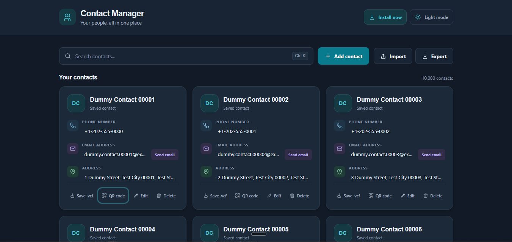
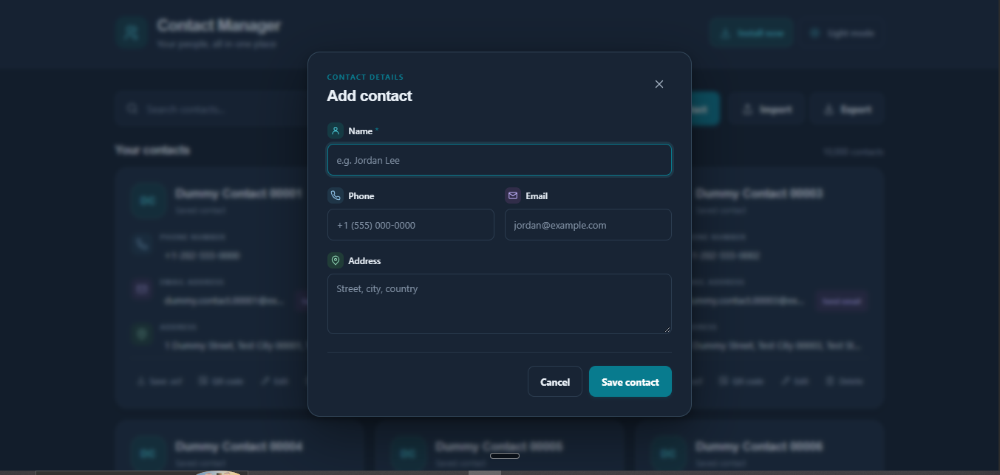
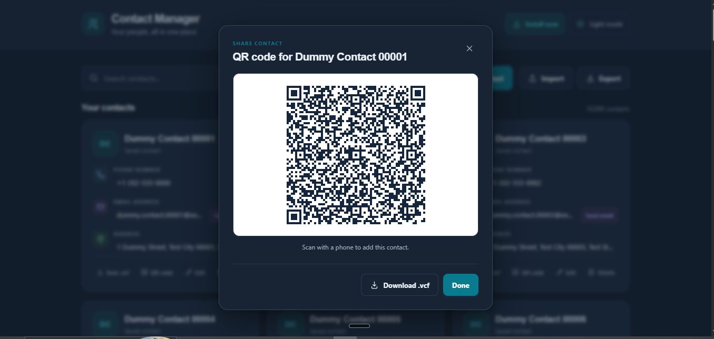
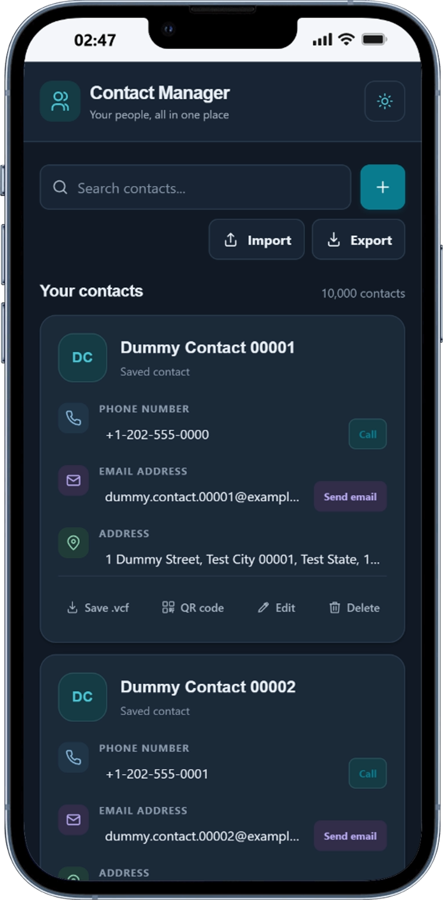

# Contact Manager

A browser-based contact manager for saving and organizing contacts on your device. It includes search, VCF import and export, QR codes, light and dark themes, and installable Progressive Web App (PWA) support.

**Live demo:** [Open Contact Manager](https://contractra.netlify.app/) <!-- Replace # with the deployed app URL. -->

## Why I built this

I recently learned about IndexedDB, the database built into web browsers, and wanted to understand it by using it in a real project. That idea became Contact Manager: a practical way to try saving, finding, editing, importing, and exporting records directly in the browser.

As the contact list grew, I also worked on making larger imports manageable and keeping the interface responsive. The project is still a learning project, and a useful place to explore browser storage, JavaScript, and Progressive Web App features together.

## Screenshots

**Contact list**



**Add a contact**



**Contact QR code**



<p align="center"><strong>Mobile layout</strong></p>
<p align="center"></p>

## Features

- Add, edit, and delete contacts.
- Search by name, phone number, email address, or address.
- Browse contacts in pages of 50 to keep the interface responsive with large contact lists.
- Click a phone number, email address, or street address to copy it. Call and email actions are available where supported by the device.
- Import `.vcf` contact files with duplicate detection, chunked saving, and visible progress.
- Export one contact or choose contacts for a VCF export.
- Create a QR code for a contact.
- Switch between light and dark themes.
- Install the app on supported devices and use its cached app shell offline after visiting it online.

## Requirements

- Node.js 20.19 or newer in the 20.x line, or Node.js 22.12 or newer.
- npm (included with Node.js).

## Run locally

From the project directory, install dependencies and start Vite:

```sh
npm install
npm run dev
```

Open the local URL printed by Vite, usually `http://localhost:5173`.

## Build and preview

Create a production build in `dist/`:

```sh
npm run build
```

Preview the production build locally:

```sh
npm run preview
```

## Import and export contacts

Use **Import** to choose a `.vcf` file. The importer reads contact names, phone numbers, email addresses, and addresses; it skips entries without a name and detects duplicates. Contacts are saved in batches of 500 while the progress indicator updates.

Use **Export** to select contacts for a VCF file, or **Save .vcf** on an individual contact card to download just that contact. The project includes `Contacts_20261008_012225.vcf`, a 10,000-contact dummy file that can be used to exercise large imports.

## Data and privacy

Contact records are stored in this browser's IndexedDB database. The app has no account, backend, or cloud synchronization. Data stays associated with the browser profile and site origin where it was created; clearing that site's browser data removes the locally stored contacts. The selected theme is stored in local storage.

The service worker caches the app shell for offline use after the app has been loaded online. The development server uses a different origin from a deployed site, so their browser data is separate.

## Project files

```text
index.html                       App markup
script.js                        Contact storage and app behavior
styles.css                       Responsive layout and themes
public/theme.js                  Theme initialization and toggle
public/pwa.js                    PWA install and service worker setup
public/service-worker.js         App shell caching
public/manifest.webmanifest      PWA metadata
public/icons/                    App icons
Contacts_20261008_012225.vcf     10,000-contact sample file
```

## Tech stack

- HTML, CSS, and JavaScript modules
- [Vite](https://vite.dev/) for development and production builds
- [qrcode](https://www.npmjs.com/package/qrcode) for contact QR codes
- IndexedDB for contact storage
